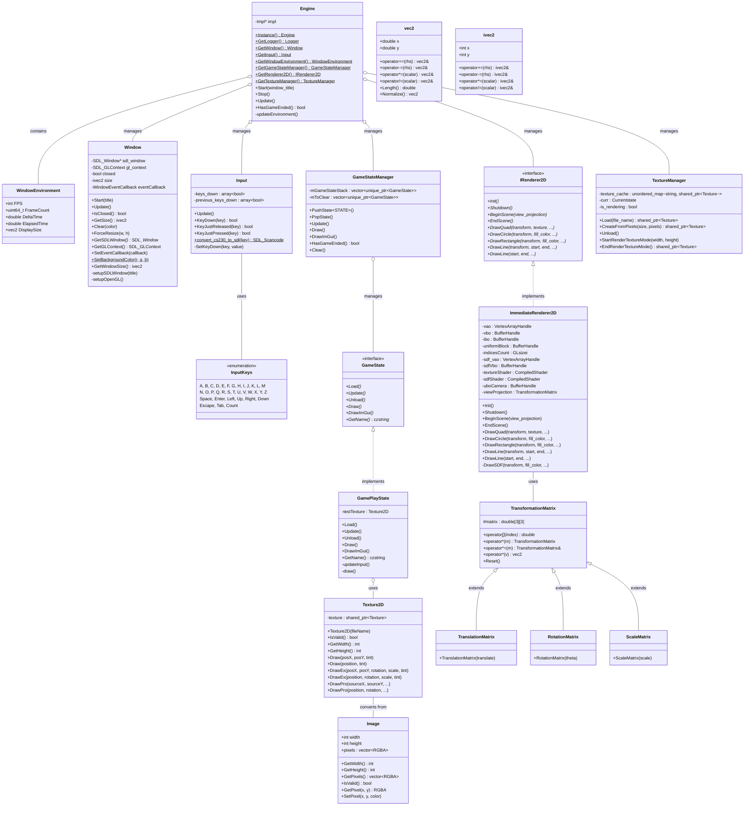

# CS200 Computer Graphics I

## How to Build and Run

First Setup your [Development Environment](docs/DevEnvironment.md)

### Command Line Build

**Windows**

```sh
# configure / generate build files
cmake --preset windows-debug
cmake --preset windows-developer-release
cmake --preset windows-release
cmake --preset web-debug-on-windows

# Build exe
cmake --build --preset windows-debug
cmake --build --preset windows-developer-release
cmake --build --preset windows-release
cmake --build --preset web-debug-on-windows
```

**Linux**
```sh
# configure / generate build files
cmake --preset linux-debug
cmake --preset linux-developer-release
cmake --preset linux-release
cmake --preset web-debug
cmake --preset web-developer-release
cmake --preset web-release

# Build exe
cmake --build --preset linux-debug
cmake --build --preset linux-developer-release
cmake --build --preset linux-release
cmake --build --preset web-debug
cmake --build --preset web-developer-release
cmake --build --preset web-release
```

### Automated Build Script

For convenience, use the automated build script that handles all configurations:

```sh
python3 scripts/scan_build_project.py
```

See the script help for filtering options:
```sh
python3 scripts/scan_build_project.py --help
```

## Build Configurations

This project supports three distinct build configurations, each designed for different stages of development and deployment:

### **Debug Configuration**
- **Purpose**: Active development and debugging
- **Features**: 
  - Allows setting breakpoints to step through code line-by-line
  - No compiler optimizations (preserves variable values for debugging)
  - Console window for viewing debug output
  - All developer helper features enabled
- **Performance**: Slower execution, larger executable size
- **When to use**: When you need to debug issues or understand code flow

### **Developer-Release Configuration**  
- **Purpose**: Testing with optimized performance while keeping developer tools
- **Features**:
  - Compiler optimizations enabled (faster execution)
  - Cannot set breakpoints (optimizations interfere with debugging)
  - Console window for viewing output
  - Verbose logging and error checking enabled
  - Developer assertions active
- **Performance**: Fast execution, optimized code
- **When to use**: Performance testing while retaining diagnostic capabilities

### **Release Configuration**
- **Purpose**: Final builds for end users
- **Features**:
  - Full compiler optimizations
  - No console window (clean user experience)
  - Minimal logging (only critical errors)
  - No developer features or extra error checking
  - Smallest executable size
- **Performance**: Maximum speed, production-ready
- **When to use**: Final builds for distribution to users

## CMake Presets

CMake presets simplify the build process by pre-configuring complex settings. Instead of manually specifying:

- Compiler flags and optimization levels
- Output directories and build paths  
- Platform-specific configurations
- Dependency locations
- Debug/release-specific settings

The presets handle all of this automatically. For example, `cmake --preset linux-debug` is equivalent to running:

```sh
cmake -S . -B build/linux-debug \
  -DCMAKE_BUILD_TYPE=Debug \
  -DCMAKE_EXPORT_COMPILE_COMMANDS=ON \
  -DDEVELOPER_VERSION=ON \
  [... many more flags ...]
```

This saves time and reduces configuration errors, especially when working across different platforms and build types.

## Class Diagram



### Diagram Explanation

This class diagram represents the **Dokev Graphics Engine** architecture for CS200 Computer Graphics I.

#### Core Systems

- **Engine**: Singleton class managing all subsystems (Window, Input, Renderer, GameState, TextureManager)
- **WindowEnvironment**: Stores runtime information (FPS, frame count, delta time, display size)

#### Game State System

- **GameState**: Abstract interface for different application states (menu, gameplay, etc.)
- **GameStateManager**: Manages state stack with push/pop operations
- **GamePlayState**: Concrete implementation for game logic

#### Rendering System

- **IRenderer2D**: Abstract interface for 2D rendering operations
- **ImmediateRenderer2D**: OpenGL-based implementation with texture and SDF shape rendering

#### Mathematics

- **TransformationMatrix**: Base class for 3x3 transformation matrices
- **TranslationMatrix, RotationMatrix, ScaleMatrix**: Specialized transformation types
- **vec2, ivec2**: 2D vector types (double and int)

#### Graphics Resources

- **TextureManager**: Manages texture loading, caching, and render-to-texture functionality
- **Texture2D**: High-level texture wrapper with draw operations
- **Image**: Raw pixel data storage and manipulation

#### Relationships

- `+` indicates public members
- `-` indicates private members
- `#` indicates protected members
- `*` indicates abstract/pure virtual methods
- `$` indicates static methods
- `<|--` shows inheritance
- `<|..` shows interface implementation
- `o--` shows composition/aggregation

